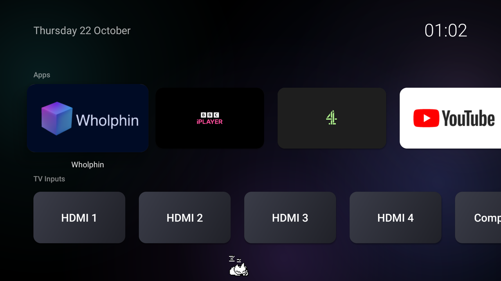

# Amazon TV Simple Launcher

A clean, Apple TV-style home screen for Fire OS 7 TVs (built for the Fire TV 4-Series, `AMZ_4k55N400U`).

- **Row 1 – Apps.** The apps you choose, in the order you choose, shown with their banners. Tiles grow when selected and the name fades in underneath.
- **Row 2 – TV Inputs.** The TV's HDMI, composite and aerial inputs, then a **Fire TV** tile (Amazon's own home screen) and **Settings**.
- **Black background** with soft glows drifting slowly behind everything.
- **HDMI and composite inputs** open full screen, straight from their tiles.
- **A cat** ([oneko](https://github.com/adryd325/oneko.js)) wanders along the bottom, sits, yawns and naps.
- **Home button** opens this screen instead of Amazon's. **Double-press Home** to stay on Amazon's.



**Full step-by-step install guide: [INSTALL.md](INSTALL.md).** The short version is below.

## 1. Build the APK

1. Install [Android Studio](https://developer.android.com/studio) if you don't have it.
2. **File → Open…** and choose this `FireHome` folder. Let it sync (first sync downloads Gradle and the Android SDK, so it takes a few minutes).
3. Build the release APK (it's optimised and much faster than the debug build). From the `FireHome` folder:
   ```sh
   ./gradlew assembleRelease
   ```
   Gradle 8.11 needs Java 17–21. If the build fails with a bare Java version number (e.g. `25.0.3`), point `JAVA_HOME` at a JDK 21 first.
4. The APK is at `app/build/outputs/apk/release/app-release.apk`.

## 2. Install it

Turn on ADB debugging on the TV (Settings → Device & Software → About, press OK 7 times on the TV's name, then Developer options → ADB debugging), note its IP address, then:

```sh
./install-on-tv.sh 192.168.x.x
```

The script installs the app and sets up the Home button. It's safe to run again for updates, or if Home stops working after a Fire OS update. [INSTALL.md](INSTALL.md) explains each step.

## How the Home button works

Fire OS won't let another app be the default home screen, and it handles Home before other apps can see the press. So a background helper (an accessibility service):

- reads the system log, where Fire OS records every Home press, and opens this screen;
- opens it through an alarm, because Android holds back screens opened by apps for 5 seconds after Home but not ones the system opens for them (the script removes the alarm's own 5-second minimum);
- also watches for Amazon's home screen appearing (after a restart or waking up) and replaces it.

## Using it

| Remote | What it does |
| --- | --- |
| Home | Opens this home screen |
| Home, Home (quickly) | Stay on Amazon's home screen |
| Hold Home | Fire TV's quick menu, as usual |
| Menu (☰) on an app | Move (◀ ▶ then OK), hide, choose apps to show, app info |
| Menu (☰) anywhere else | Home button on/off, choose apps to show, reorder apps, cat on/off |
| Back | Nothing (it's the home screen) |

Selecting the **Fire TV** tile also takes you to Amazon's home screen. Press Home to come back here.

## If something goes wrong

- **Home button stops working after a Fire OS update.** Amazon sometimes resets the settings it relies on; run `./install-on-tv.sh` again.
- **Stuck or want stock back.** Double-press Home, or Menu → *Home button opens this screen: Off*, or uninstall: `adb uninstall xyz.bodyparts.home`.
- **An input won't open.** Inputs are shown with Android's TV input framework, the same way Amazon's own player does it. If one doesn't work on your TV, please [open an issue](https://github.com/tomtomwillis/Amazon-TV-Simple-Launcher/issues).
- **Debug log.** `adb logcat -s HomeCatch` shows what the Home-button helper sees.

## Project layout

```
app/src/main/java/xyz/bodyparts/home/
  MainActivity.kt      the home screen: rows, launching, menus, moving apps
  TileView.kt          the Apple TV-style tile, focus and move animations
  CatView.kt           the cat
  AmbientBackgroundView.kt  the black background with drifting glows
  RowScroller.kt       keeps the selected tile inside the row's margins
  InputPlayerActivity.kt    full-screen HDMI / composite input
  HomeCatchService.kt  the Home-button helper (accessibility service)
  HomePressWatcher.kt  spots Home presses in the system log
  Prefs.kt             saved app order, hidden apps, switches
install-on-tv.sh       installs/updates the app and sets up the Home button
third_party/           licence for the cat sprites
```

## Credits and licence

- MIT licensed: see [LICENSE](LICENSE).
- The cat sprites come from [oneko.js](https://github.com/adryd325/oneko.js) by adryd (MIT): see [third_party/oneko-LICENSE.txt](third_party/oneko-LICENSE.txt).
- Not affiliated with or endorsed by Amazon. Fire TV and Fire OS are trademarks of Amazon.
